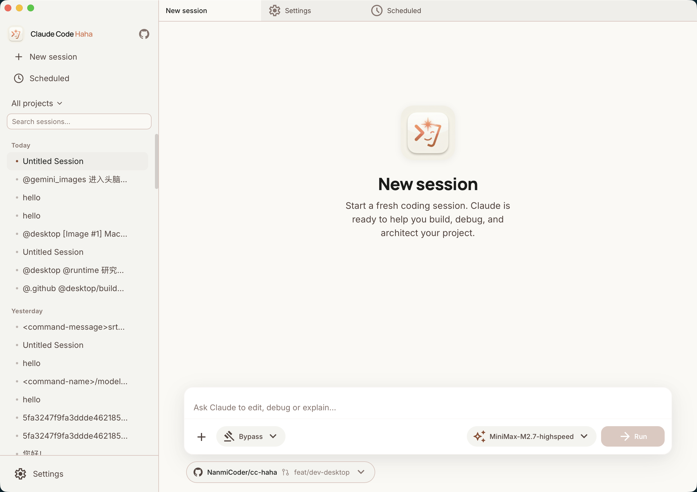
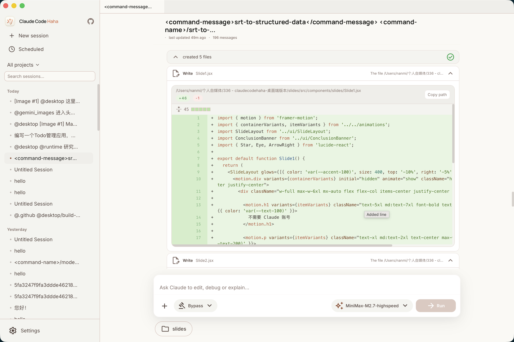
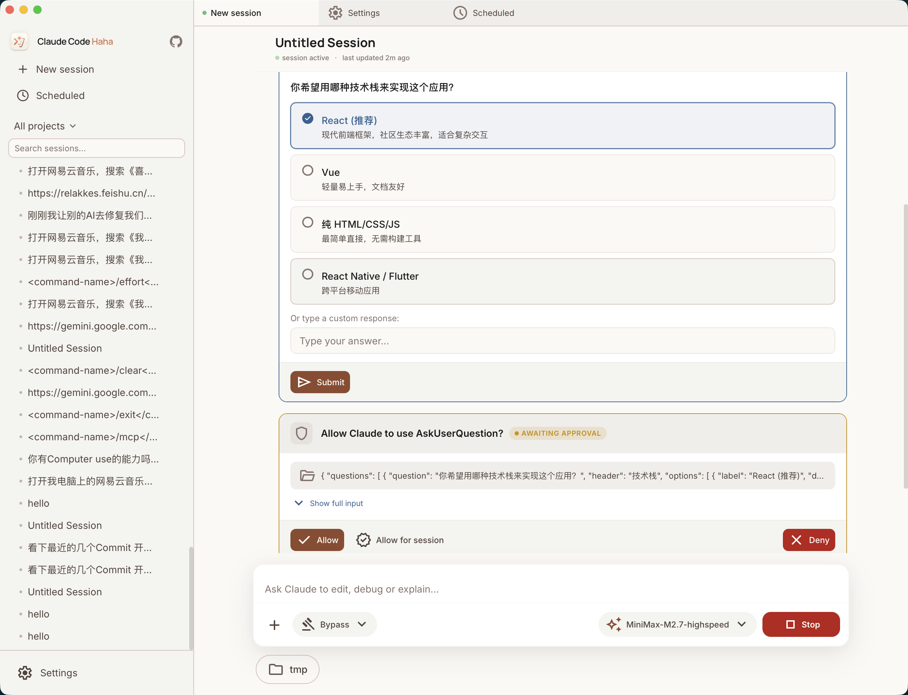
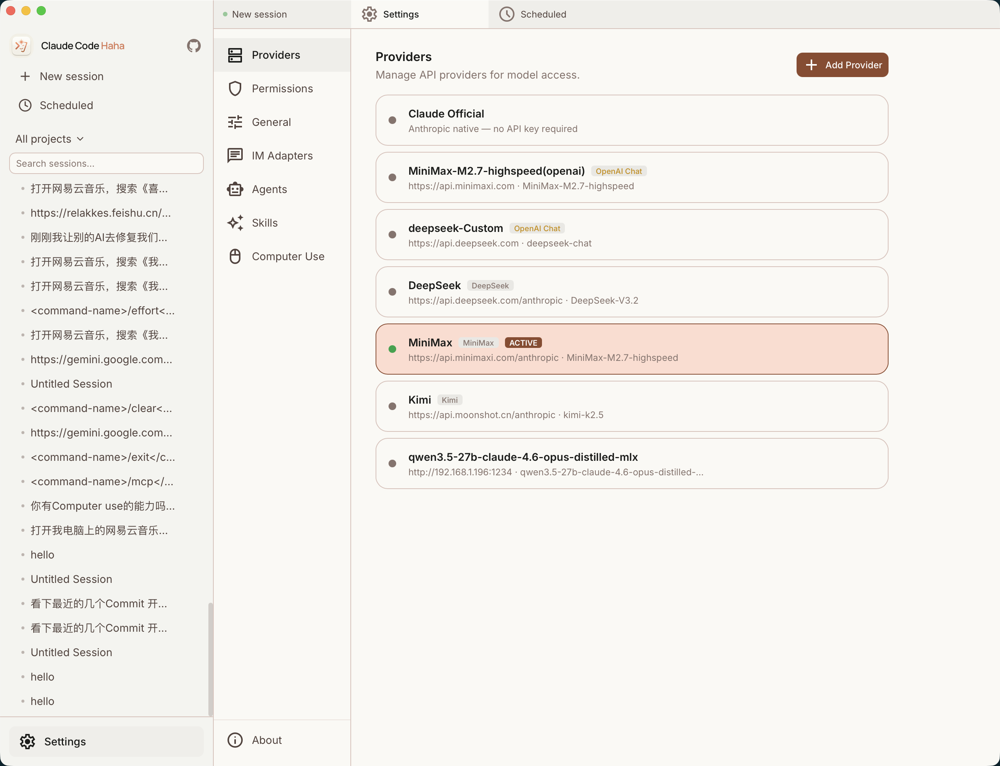
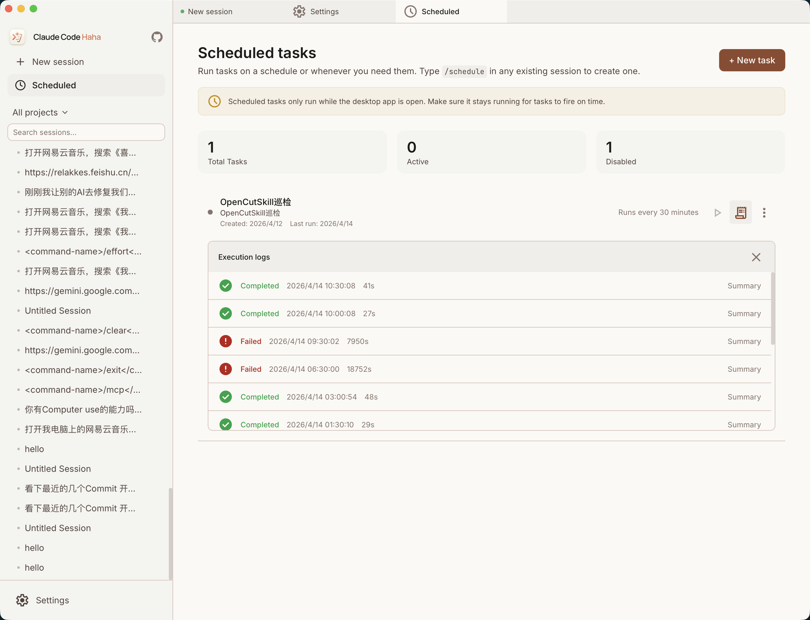
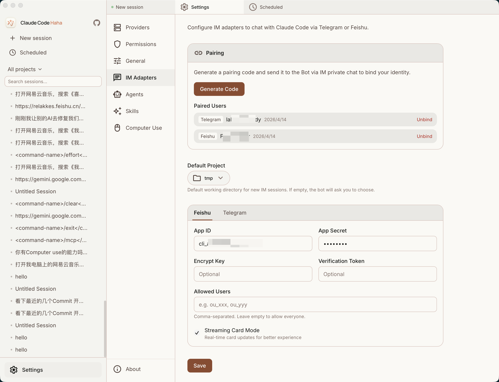

# AmbiCrew

<p align="center">
  
</p>

<div align="center">

[](https://github.com/NanmiCoder/cc-haha/blob/main/LICENSE)

</div>

AmbiCrew 是一个 AI 驱动的智能编程助手，支持 CLI 和桌面端两种使用方式。支持接入任意 Anthropic 兼容 API（MiniMax、OpenRouter 等），提供 Computer Use（macOS / Windows）桌面控制、多 Agent 协作、Skills 扩展系统、IM 远程驱动（Telegram / 飞书 / 微信 / 钉钉），以及完整的 **Electron 桌面端**。

<p align="center">
  <a href="#桌面端预览">桌面端</a> · <a href="#功能">功能</a> · <a href="#快速开始">快速开始</a> · <a href="#更多文档">更多文档</a>
</p>

---

## 桌面端预览

AmbiCrew 桌面端基于 Electron + React，将会话管理、多项目、代码 Diff、权限确认、提供商配置、定时任务、IM 适配器和 CLAUDE.md 编辑器集中到一个图形化工作台里。

<table>
  <tr>
    <td align="center" width="33%"><br><b>主界面</b></td>
    <td align="center" width="33%"><br><b>代码编辑 & Diff 视图</b></td>
    <td align="center" width="33%"><br><b>权限控制 & AI 提问</b></td>
  </tr>
  <tr>
    <td align="center" width="33%"><br><b>多提供商管理</b></td>
    <td align="center" width="33%"><br><b>定时任务</b></td>
    <td align="center" width="33%"><br><b>IM 适配器（Telegram / 飞书 / 微信 / 钉钉）</b></td>
  </tr>
</table>

---

## 功能

- 完整的 Ink TUI 交互界面
- `--print` 无头模式（脚本/CI 场景）
- 支持 MCP 服务器、插件、Skills
- 支持自定义 API 端点和模型
- **CrewCentral OAuth 集成** — 统一账号登录与 Token 管理
- **Skill Hub** — 从 CrewCentral 下载和安装 Skills
- **CLAUDE.md 编辑器** — 桌面端可视化管理 CLAUDE.md 配置文件
- **记忆系统** — 跨会话持久化记忆
- **多 Agent 系统** — 多代理编排、并行任务
- **Skills 系统** — 可扩展能力插件、自定义工作流
- **IM 接入** — 通过 Telegram / 飞书 / 微信 / 钉钉远程对话、切换项目和审批权限
- **Computer Use 桌面控制** — macOS / Windows 截屏、鼠标、键盘操作
- **桌面端** — Electron + React 图形化客户端，多标签多会话
- **定时任务** — 支持 Cron 定时调度
- 降级 Recovery CLI 模式

---

## 技术栈

| 类别 | 技术 |
|------|------|
| 运行时 | [Bun](https://bun.sh) |
| 语言 | TypeScript |
| 终端 UI | React + [Ink](https://github.com/vadimdemedes/ink) |
| 桌面端 | Electron + React + Vite + Tailwind CSS |
| CLI 解析 | Commander.js |
| API | Anthropic SDK |
| 协议 | MCP, LSP, WebSocket |
| IM 适配器 | Telegram, 飞书, 微信, 钉钉 |

---

## 快速开始

### 1. 安装 Bun

```bash
# macOS / Linux
curl -fsSL https://bun.sh/install | bash

# macOS (Homebrew)
brew install bun

# Windows (PowerShell)
powershell -c "irm bun.sh/install.ps1 | iex"
```

> 精简版 Linux 如提示 `unzip is required`，先运行 `apt update && apt install -y unzip`

### 2. 安装依赖并配置

```bash
bun install
cp .env.example .env
# 编辑 .env 填入你的 API Key
```

### 3. 启动 CLI

#### macOS / Linux

```bash
./bin/claude-haha                          # 交互 TUI 模式
./bin/claude-haha -p "your prompt here"    # 无头模式
./bin/claude-haha --help                   # 查看所有选项
```

#### Windows

> **前置要求**：必须安装 [Git for Windows](https://git-scm.com/download/win)

```powershell
# PowerShell / cmd 直接调用 Bun
bun --env-file=.env ./src/entrypoints/cli.tsx

# 或在 Git Bash 中运行
./bin/claude-haha
```

### 4. 全局使用（可选）

将 `bin/` 加入 PATH 后可在任意目录启动：

```bash
export PATH="$HOME/path/to/ambicrew/bin:$PATH"
```

### 5. 启动桌面端

#### 5.1 启动服务端

```bash
SERVER_PORT=3456 bun run src/server/index.ts
```

可选自检：

```bash
curl http://127.0.0.1:3456/health
```

#### 5.2 启动桌面前端

```bash
cd desktop
bun run dev --host 127.0.0.1 --port 2024
```

然后在浏览器打开 `http://127.0.0.1:2024`

#### 5.3 构建桌面应用

```bash
cd desktop
npm run dist     # 打包为可分发的安装包 (NSIS/DMG/AppImage)
```

---

## 项目结构

| 目录 | 说明 |
|------|------|
| `src/cli/` | CLI 核心逻辑 |
| `src/server/` | API 服务端（REST + WebSocket） |
| `src/services/` | 核心服务（MCP, LSP, OAuth, Skill Hub 等） |
| `src/utils/` | 工具函数 |
| `src/vendor/` | 第三方模块（Computer Use MCP 等） |
| `desktop/` | Electron 桌面端 |
| `adapters/` | IM 适配器（Telegram / 飞书 / 微信 / 钉钉） |
| `runtime/` | Python 运行时辅助（Computer Use） |

---

## 更多文档

| 文档 | 说明 |
|------|------|
| [环境变量](docs/guide/env-vars.md) | 完整环境变量参考和配置方式 |
| [第三方模型](docs/guide/third-party-models.md) | 接入 OpenAI / DeepSeek / Ollama 等非 Anthropic 模型 |
| [Computer Use](docs/features/computer-use.md) | 桌面控制功能（截屏、鼠标、键盘） |
| [IM 接入](docs/im/) | 通过 Telegram / 飞书 / 微信 / 钉钉远程驱动 |
| [桌面端](docs/desktop/) | Electron + React 图形化客户端 |
| [全局使用](docs/guide/global-usage.md) | 在任意目录启动 |
| [常见问题](docs/guide/faq.md) | 常见错误排查 |

---

## 感谢

感谢以下开源项目为本项目提供参考与启发：

- [React](https://github.com/facebook/react) — UI 组件化框架
- [Electron](https://github.com/electron/electron) — 跨端桌面应用框架
- [Ink](https://github.com/vadimdemedes/ink) — React 终端 UI 渲染
- [Bun](https://bun.sh) — JavaScript/TypeScript 运行时
